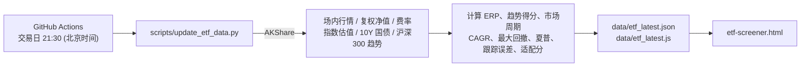

# life-tools

Small tools for daily life —— 生活工具箱 · LifeTools

一组**零构建、零依赖安装**的单文件 HTML 小工具合集，覆盖投资分析、宏观研究、量化筛选、学习复习与日常生活。每个工具都是一个独立的 `.html` 文件，双击即可在浏览器中打开使用，统一由 [index.html](index.html) 首页导航。

## ✨ 特性

- **单文件即工具**：HTML / CSS / JS 内联在同一文件中，无需 `npm install`、无需打包
- **开箱即用**：本地 `file://` 直接打开，或部署到 GitHub Pages 等任意静态托管
- **统一入口**：首页支持关键词搜索与分类筛选（投资 / 宏观 / 价值 / 量化 / 生活 等）
- **全站主题同步**：首页一键切换「自动 / 深色 / 浅色」与「经典 / 科技 / 清新 / 书卷」四种风格（4 风格 × 明暗 = 8 套配色），全部 12 个页面默认跟随首页，也可在各页挂件里单独设置；刷新不闪白，多标签页无刷新同步，每套配色都经过对比度审计（见 [全站主题同步机制](#-全站主题同步机制)）
- **数据自动更新**：ETF 筛选器的行情数据由 GitHub Actions 在交易日自动抓取并提交

## 🧰 工具清单

### 投资 · 价值 · 量化

| 工具 | 文件 | 说明 |
| --- | --- | --- |
| 格雷厄姆廉价股计算器 | [graham-calculator.html](graham-calculator.html) | PE / PB / NCAV 多维度价值判断，EPS 均值计算，内在价值评级，含 AI 炒股提示词生成器 |
| DCF 现金流折现计算器 | [dcf-calculator.html](dcf-calculator.html) | DCF + PE + PB 三维估值，自由现金流预测、折现率调整、多情景模拟与敏感性分析 |
| 基金债券收益计算器 | [earnings-calculator.html](earnings-calculator.html) | 基金、债券的固定收益与预期收益计算 |
| 周期 ETF / 指数基金智能筛选器 | [etf-screener.html](etf-screener.html) | 股债性价比 ERP + 估值分位 + 均线动量三维周期诊断，六大类 ETF 多维筛选、同指数雷达 PK 与攻守仓位配比 |
| TAR 技术面分析手册 | [technical_analysis_guide_cn.html](technical_analysis_guide_cn.html) | K 线形态、量价关系、指标速查、市场情绪分析 |

### 宏观 · 认知

| 工具 | 文件 | 说明 |
| --- | --- | --- |
| 全球地缘战略地图 | [geopolitical-map.html](geopolitical-map.html) | GeoStrategy Atlas：地缘政治、宏观分析、国家间关系可视化（D3 + TopoJSON） |
| 认知成长核心书单与进阶追踪 | [reading_list_card.html](reading_list_card.html) | 经典著作结构化导读，涵盖认知跃迁、复杂系统与宏观决策，支持交互式阅读进度追踪 |

### 学习 · 生活

| 工具 | 文件 | 说明 |
| --- | --- | --- |
| 前端面试宝典 | [frontend-interview-guide.html](frontend-interview-guide.html) | 前端面试笔记复习，提供解题模式与答案对比；主题与风格默认跟随首页，可在悬浮挂件里独立设置（侧栏按钮可快速切换明暗） |
| iPhone 17 Pro Max 摄影与录像实战工坊 | [iphone17-pro-camera-master.html](iphone17-pro-camera-master.html) | 焦段透视、180° 快门、ProRAW 与 Apple Log 2 原理拆解，十大场景参数卡，构图与姿态引导 |
| 羽毛球费用 AA 计算器 | [badminton-cost-calculator.html](badminton-cost-calculator.html) | 两种模式：**⚡ 极速平摊**（总费用 + 人数，快捷人数芯片，输入即时出结果）与 **📋 精细分账**（每人各自垫付不同金额，自动算出最少转账路径，可指定组织者统一收款）；金额精确到分，一键复制微信 / 群聊账单文案；4 风格 × 深浅色，手机端可用。算法说明见 [羽毛球平摊算法](#-羽毛球平摊算法) |
| 提肛运动计时器 | [anal-lifting-trainer.html](anal-lifting-trainer.html) | 训练倒计时与计数，可自定义组数、时长与强度 |

### 🚧 即将上线

- 仓位管理 · 凯利公式
- 股息再投资复利计算
- 宏观指标分析看板

## 🚀 快速开始

```bash
git clone https://github.com/longyi-xw/life-tools.git
cd life-tools
```

**方式一：直接打开**

双击 `index.html`，或任意工具的 `.html` 文件即可。

**方式二：本地静态服务（推荐，ETF 筛选器可通过 `fetch` 读取最新 JSON）**

```bash
# 任选其一
python -m http.server 8080
npx serve .
```

然后访问 <http://localhost:8080>。

> 部分页面会从公共 CDN 加载第三方库（ECharts、D3、TopoJSON、Font Awesome），离线环境下相关图表或图标可能无法显示。

## 📈 ETF 数据自动更新

[etf-screener.html](etf-screener.html) 的数据来源按优先级依次为：

1. `fetch ./data/etf_latest.json`（HTTP / HTTPS 访问时）
2. `<script src="./data/etf_latest.js">` 挂载的 `window.__ETF_LATEST_DATA__`（兼容 `file://` 直接打开）
3. 页面右上角手动导入 JSON / JS 文件
4. HTML 内置的兜底快照

### 数据流



- 工作流：[.github/workflows/update-etf.yml](.github/workflows/update-etf.yml)，周一至周五 UTC 13:30 定时执行，也支持在 Actions 页面手动触发（`workflow_dispatch`）
- 数据无变化（非交易日或接口均失败）时自动跳过提交
- 容错原则：任一接口失败、限流或超时都会保留上一版字段，仅更新成功获取的数据

### 本地手动更新

```bash
pip install akshare pandas

python scripts/update_etf_data.py                       # 联网全量更新
python scripts/update_etf_data.py --offline             # 不联网，仅按算法重算派生字段
python scripts/update_etf_data.py --sync-html-fallback  # 额外刷新 etf-screener.html 内置兜底快照
```

> [!IMPORTANT]
> 脚本中的 `MarketRegimeEngine` 与 `etf-screener.html` 中 `<script id="engine">` 的前端引擎逐行对齐，修改任何阈值或权重时请两边同步修改。

## 🎨 全站主题同步机制

主题由两个**正交维度**组成：**明暗**（`dark` / `light`）× **风格**（`classic` 经典 / `tech` 科技 / `fresh` 清新 / `paper` 书卷），共 4 × 2 = 8 套配色。首页是主控，子页默认跟随、可单页覆盖。三类文件各司其职：

| 文件 | 角色 |
| --- | --- |
| [theme-manager.js](theme-manager.js) | 零依赖的主题中枢（`window.LifeToolsTheme`）：读写存储、解析生效的明暗与风格、写 `<html>` 属性、广播事件、渲染子页主题挂件 |
| [theme-tokens.css](theme-tokens.css) | 共享令牌：8 个 `html[data-style="…"][data-theme="…"]` 块，提供 `--lt-bg` / `--lt-surface` / `--lt-text` / `--lt-accent` / `--lt-good` 等语义变量，头注释里有完整的令牌语义表与各风格设计意图 |
| 各页面 | 在自己的 `<style>` 里用一个 `LT-THEME-MAP` 映射块把页面变量别名到 `--lt-*` 令牌 |

目前 12 个页面全部接入，`pageId` 取文件名短 slug、全站唯一：

| pageId | 页面 | pageId | 页面 |
| --- | --- | --- | --- |
| `home` | index.html（主控，自带切换器，不使用挂件） | `camera` | iphone17-pro-camera-master.html |
| `badminton` | badminton-cost-calculator.html | `reading` | reading_list_card.html |
| `interview` | frontend-interview-guide.html | `technical` | technical_analysis_guide_cn.html |
| `dcf` | dcf-calculator.html | `etf` | etf-screener.html |
| `graham` | graham-calculator.html | `geopolitical` | geopolitical-map.html |
| `earnings` | earnings-calculator.html | `trainer` | anal-lifting-trainer.html |

### 存储与模式

偏好保存在 `localStorage`，读写全部容错（存储被禁用时退化为内存值，不会报错）；非法或缺失的存储值一律按默认值处理，写入非法值会被忽略。页面自己不得再建主题存储键，只允许 `lifetools_*`：

| 键 | 取值 | 默认 | 说明 |
| --- | --- | --- | --- |
| `lifetools_global_theme` | `auto` / `dark` / `light` | `auto` | 全局明暗，由首页顶栏的「自动 / 深色 / 浅色」切换器写入；`auto` 跟随系统明暗 |
| `lifetools_global_style` | `classic` / `tech` / `fresh` / `paper` | `classic` | 全局风格，由首页顶栏的四个风格色块写入 |
| `lifetools_page_theme_<pageId>` | `follow` / `dark` / `light` / `system` | `follow` | 单页明暗覆盖，仅子页使用 |
| `lifetools_page_style_<pageId>` | `follow` / `classic` / `tech` / `fresh` / `paper` | `follow` | 单页风格覆盖，仅子页使用 |

- **首页**：全局明暗三种模式 + 全局风格四选一；`home` 没有页面级覆盖，生效值恒等于全局解析结果。
- **子页**：在页面的主题挂件里分别选择明暗（跟随首页 `follow`（默认）/ 浅色 / 深色 / 跟随系统 `system`，后者无视首页、直接看系统）与风格（跟随首页 + 四种风格）。两个维度各自独立覆盖、各自持久化，随时可恢复「跟随首页」。挂件内键盘可达（方向键 / Home / End / Esc），触控目标不小于 40px。
- 没有 `matchMedia` 的环境，`auto` / `system` 按深色处理。

### DOM 契约、防闪烁与跨标签页同步

- **DOM 契约**：生效结果写在 `<html data-theme="dark|light" data-style="classic|tech|fresh|paper">`，同时设置 `color-scheme`（滚动条、表单控件等原生部件跟随明暗）。**页面样式只依赖这两个属性，不依赖 class。**
- **防闪烁（Anti-FOUC）**：每个页面在 `<head>` 里、任何 `<style>` 之前**同步**加载 `theme-manager.js`、调用 `initAntiFOUC(pageId)` 并引入 `theme-tokens.css`，在首次绘制前就把明暗与风格都写好，刷新不会先闪一下浅色 / 深色 / 别的风格。
- **跨标签页**：浏览器只会在*其它*标签页触发 `storage` 事件，`initAntiFOUC` 注册的监听同时响应明暗键与风格键，无需刷新即可同步；本标签页内的修改由 `setGlobalTheme` / `setGlobalStyle` / `setPageTheme` / `setPageStyle` 直接重新应用。同时监听系统明暗的 `change`（兼容旧版 `addListener`）以及从 bfcache 恢复页面（`pageshow`）。
- **事件**：每次应用都会在 `window` 上派发 `lifetools:themechange`，`detail = { pageId, theme, mode, style, styleMode }`（`theme` / `style` 是生效的明暗与风格，`mode` / `styleMode` 是该页当前的设置项）。页面用 `LifeToolsTheme.onChange(cb)` 订阅，用来同步自己的 UI 状态，或重绘 ECharts / Canvas / SVG / 地图等 JS 绘制内容（重绘时用 `getComputedStyle(document.documentElement)` 读 CSS 变量，换主题后不残留旧色）。
- **容错**：`theme-manager.js` 或 `theme-tokens.css` 加载失败时页面不会报错，映射块里每个 `var(--lt-…, 回退值)` 都带有页面原值的回退。

> `file://` 下各浏览器对 `localStorage` 的共享策略不同，若发现首页与子页之间不同步，请改用本地静态服务（`python -m http.server`）或 GitHub Pages 访问。

### theme-tokens.css 与四种风格

| 风格 | 深色 | 浅色 |
| --- | --- | --- |
| `classic` 经典 | 黑金，即各页「原生配色」 | 米白金 |
| `tech` 科技 | 深蓝黑底 + 青 / 电光蓝，细网格 + 极淡扫描线，小圆角，标题等宽 | 冷白蓝灰底 + 深蓝强调 |
| `fresh` 清新 | 深青绿底 + 薄荷强调，大圆角，柔和光晕 | 薄荷 / 天空蓝淡底 + 青绿强调，大圆角 |
| `paper` 书卷 | 深棕褐暖灰底 + 琥珀强调，标题衬线 | 暖纸色 + 墨色正文 + 朱砂 / 棕红点缀，淡横格 |

- **classic = 页面原生配色**：深色页的 `:root` 就是 classic 深色（零视觉回归），浅色由页面自己的 `html[data-theme="light"]` 块提供（浅色页反之）。`tech` / `fresh` / `paper` 才通过映射块别名到共享令牌。
- **强调色两个明度**：`--lt-accent` 用于填充 / 装饰（按钮底、色块、进度条），`--lt-accent-strong` 专用于文字 / 链接，二者对相邻底色的对比度要求不同。
- **对比度与舒适度**：正文与小字 ≥ 4.5:1，大字 ≥ 3:1，弱化文字也按小字计、不靠 `opacity` 压低；控件边界、图标、焦点环 ≥ 3:1；深色底不用纯黑、正文不用纯白，浅色底不用纯白、正文不用 `#000`，主正文落在 9:1–15:1。状态（涨跌 / 盈亏 / 成功 / 警告）不只靠颜色区分，另有符号、文字或形状。每套「风格 × 明暗」由 `scripts/audit-contrast.mjs` 独立审计。

### 给新页面接入（head 四行）

在 `<head>` 中、任何 `<style>` 之前，按此顺序同步加载（不要 `async` / `defer` / `media`）：

```html
<meta name="color-scheme" content="light dark">
<script src="theme-manager.js"></script>
<script>window.LifeToolsTheme && LifeToolsTheme.initAntiFOUC('your-page-id');</script>
<link rel="stylesheet" href="theme-tokens.css">
```

然后在页面 `<style>` 里加映射块（注释标记 `LT-THEME-MAP` 供检查脚本识别；必须带回退值，回退值 = 页面原值）：

```css
/* LT-THEME-MAP */
html[data-style]:not([data-style="classic"]) {
  --bg: var(--lt-bg, #0b0f14);
  --text: var(--lt-text, #e2e6ec);
  --muted: var(--lt-text-muted, #8b95a8);
  --accent: var(--lt-accent, #c8a84b);  /* 填充 / 装饰；文字、链接用 --lt-accent-strong */
}
```

该选择器的特异性高于页面 `:root` 与 `html[data-theme="light"]`，无需 `!important`。最后在 `<body>` 里调用 `LifeToolsTheme.mountThemeControl('your-page-id')`（悬浮，`position` 可选 `bottom-right` / `bottom-left` / `top-right` / `top-left`），或传入 `{ container: 元素 }` 渲染成内联控件（优先放进页面自带的顶栏）。同一 `pageId` 重复调用只会保留一个挂件；`initAntiFOUC` 与 `mountThemeControl` 的 `pageId` 必须一致，传入 `'home'` 不会渲染任何内容。

## 🏸 羽毛球平摊算法

算法在 [badminton-algorithm.js](badminton-algorithm.js) 中实现：纯函数、不碰 DOM、零依赖，浏览器里通过 `window.BadmintonAlgo`（以及同名全局函数）使用，Node 下可 `require()`。所有失败都返回 `{ ok: false, error: '中文提示' }`，不抛异常。

- **整数分精度**：金额按十进制字符串换算成「分」（第 3 位小数起四舍五入），之后全部用整数运算，输出时才转回保留 2 位小数的数值，不依赖浮点累加，也不会出现 `0.1 + 0.2` 之类的误差。单个金额上限 10 亿元。
- **⚡ 极速平摊**（`calculateQuickSplit`）：收款人先垫付全款，其余 N-1 人每人转给收款人 `floor(总额分 / N)`；除不尽的零头（最多 N-1 分）由收款人自己承担，总额精确闭合。N = 1 时无需转账。
- **📋 精细分账**（`calculateDetailedSplit`）：每人应摊份额按分整除，余数分依次多摊 1 分（先给指定收款人，再按垫付金额从大到小）；`差额 = 应摊 - 已垫付`，大于 0 表示应付出，小于 0 表示应收回，所有人差额之和恒为 0。
  - 总费用留空则自动合计各人支出；填写的总额比支出合计多时，必须指定一位「差额承担人」把差额记在 TA 名下，比合计少则报错。
  - 球友以 `id` 为键，姓名可以重复；删除中间编号后新增球友由 `getNextPlayerNumber` 补位到最小未占用编号。
- **三种清算方式**：
  - **智能自适应**（`auto`，默认）：有差额的人恰好是 1 个付款人 + 1 个收款人时**点对点直连**，无需第三方中转；否则走最少转账。
  - **最少转账**（`min_transfer`）：先剔除差额为 0 的人。非零人数 ≤ 16 时用位掩码 DP 求「和为 0 的子集的最大不相交划分」，转账笔数 = 非零人数 - 组数，这是真正的最小值；组内再按「最大欠款者 → 最大应收者」的贪心生成转账。超过 16 人时退化为「先精确配对、再最大对最大贪心」，结果可用但不保证最少。
  - **统一收款**（`star`）：指定一位组织者，欠钱的人都转给 TA，TA 再转给该收回钱的人；简单直观，笔数可能更多。
- **确定性**：同样的输入一定得到同样的输出，并列情况按输入顺序处理。结果里附带 `routeType`、`savedTransfers`（相比统一收款节省的笔数）和中文 `hint`。
- **账单文案**：`buildQuickBillText` / `buildDetailedBillText` 生成无 Markdown 的纯文本，可直接粘贴到微信或群聊；页面里「复制微信账单」优先用 Clipboard API，不可用时回退到 `execCommand('copy')`。

页面侧的限制：极速平摊人数 ≤ 999，精细分账最多 30 位球友。

## 🧪 测试

`tests/` 下是两个无需构建的测试页，直接在浏览器中打开即可，页面标题与顶部汇总会显示通过 / 失败数量：

- [tests/test-theme-manager.html](tests/test-theme-manager.html)：明暗与风格两个维度的默认值与非法值回退、主题 / 风格解析、`home` 忽略页面级覆盖、`applyTheme` 与事件（含 `detail.style`）、防闪烁初始化（`data-theme` 与 `data-style` 在 `<head>` 内就绪）与监听幂等、跨文档 `storage` 事件、存储不可用时的降级、挂件的挂载 / 风格分区 / 键盘操作 / 卸载
- [tests/test-badminton-algorithm.html](tests/test-badminton-algorithm.html)：快速平摊、直连、最少转账、统一收款、余数分与差额、重名与重复 id、非法输入、编号补位、账单文案，以及随机性质测试（转账后每人净额归零、无自转账与往返、最少转账笔数不超过统一收款；非零人数 ≤ 8 时与暴力枚举对照）

也可以在无头 Chrome 里取回渲染后的结果：

```bash
chrome --headless=new --allow-file-access-from-files --virtual-time-budget=8000 --dump-dom file:///绝对路径/tests/test-theme-manager.html
```

## 📁 目录结构

```text
life-tools/
├── index.html                        # 首页导航（搜索 + 分类筛选 + 全站主题与风格切换器）
├── theme-manager.js                  # 全站主题中枢（window.LifeToolsTheme：明暗 × 风格）
├── theme-tokens.css                  # 共享主题令牌（4 风格 × 明暗 = 8 套 --lt-* 变量）
├── badminton-algorithm.js            # 羽毛球平摊算法（纯函数，浏览器 / Node 通用）
├── *.html                            # 各独立工具页面
├── CLAUDE.md                         # 项目规则与「新页面主题强制清单」（Claude 必读）
├── tests/
│   ├── test-theme-manager.html       # 主题中枢单元测试
│   └── test-badminton-algorithm.html # 羽毛球算法单元测试
├── data/
│   ├── etf_latest.json               # ETF 最新数据（HTTP 模式读取）
│   └── etf_latest.js                 # 同一份数据的 JS 包装（file:// 模式读取）
├── docs/superpowers/plans/           # 实施计划归档
├── scripts/
│   ├── update_etf_data.py            # ETF 数据采集与指标计算脚本
│   ├── check-theme.mjs               # 主题接入静态检查（Node 22，零依赖，只读）
│   ├── audit-contrast.mjs            # 对比度审计（Node 22 + 无头 Chrome，零依赖）
│   └── audit-states/                 # 额外审计状态：<pageId>.json（切标签页 / 弹窗 / 结果面板等）与 _example.json
└── .github/workflows/
    └── update-etf.yml                # 交易日定时更新 ETF 数据
```

## ➕ 新增一个工具

> **新增或大改任何页面时，必须先按主题强制清单同步首页主题，再做业务功能。** 完整清单与项目规则见 [CLAUDE.md](CLAUDE.md)。

1. 在根目录新建 `your-tool.html`，样式与脚本内联，不引入构建依赖，也不新增第三方库 / Web 字体
2. 在 `<head>` 中补充 `<title>`、`description` 与内联 SVG favicon（`<link rel="icon" type="image/svg+xml" href="data:image/svg+xml,…">`），保持与现有页面一致
3. **接入全站主题（必选）**，按 [给新页面接入（head 四行）](#给新页面接入head-四行) 完成，要点：
   - `<head>` 四行标准接入，位于任何 `<style>` 之前，缺文件时页面不报错；
   - 样式只依赖 `html[data-theme]` 与 `html[data-style]`，`classic` = 页面原生配色（另一明暗自己补一块），其余风格靠 `LT-THEME-MAP` 映射块；
   - `<body>` 里挂载主题挂件，`pageId` 取文件名短 slug、全站唯一；
   - ECharts / Canvas / SVG 等 JS 绘制内容用 `getComputedStyle` 读变量，并订阅 `LifeToolsTheme.onChange` 重绘；
   - 不自建主题存储键（只允许 `lifetools_*`），不使用 `prefers-color-scheme`（跟随系统由 `auto` / `system` 模式承担）；
   - 页面有默认视图之外的隐藏态（标签页、弹窗、筛选结果、展开项等）时，补 `scripts/audit-states/<pageId>.json`。
4. 在 [index.html](index.html) 的「已上线」区域添加一张 `tool-card`，填写 `href`、`data-name`（搜索关键词）与 `data-cat`（分类：`life` / `macro` / `value` / `quant` / `risk`，可空格组合）
5. 在本 README 的工具清单、目录结构与 pageId 一览中补充说明
6. 跑门禁（见下），4 风格 × 明暗全部通过再提交

### 主题门禁脚本

两个开发期脚本，Node 22、零 npm 依赖，不进入页面运行时：

```bash
# 静态规则：head 四行顺序、LT-THEME-MAP、无 prefers-color-scheme、无自建主题存储键、pageId 唯一且与挂件一致、首页卡片、favicon
node scripts/check-theme.mjs                     # 全站逐页表格；任一失败退出码非 0
node scripts/check-theme.mjs --page badminton    # 只看某页（pageId 或文件名，逗号分隔多个）
node scripts/check-theme.mjs --json              # 机读输出；另有 --root <dir> 指向别的站点根目录

# 对比度审计（需要本机 Chrome，无头运行；默认遍历 页面 × 4 风格 × 明暗 + audit-states 里声明的额外状态）
node scripts/audit-contrast.mjs                              # 全站 96 个组合
node scripts/audit-contrast.mjs --page badminton             # 只审某页
node scripts/audit-contrast.mjs --page etf --style tech --theme dark   # 只审某个风格 / 明暗（逗号分隔多值）
node scripts/audit-contrast.mjs --page badminton --width 390 --height 844   # 窄屏
node scripts/audit-contrast.mjs --page badminton --shots ./shots           # 同时保存整页截图，供肉眼复核
node scripts/audit-contrast.mjs --page badminton --console   # 同时统计控制台 error / warning 与未捕获异常
```

审计会计算文字与叠加后有效背景的对比度，并检查控件边界、焦点环与内联 SVG 图形；有违规退出码为 1（页面加载失败、`data-theme` / `data-style` 与预期不符、状态步骤失败或 Chrome 无法启动为 2），`--strict` 时「需人工复核」项也算失败。其余选项（`--state` / `--no-states` / `--thin` / `--json` / `--chrome` 等）见脚本头注释。「需人工复核」项（渐变文字、canvas 区域等）要对照截图逐条确认。

提交信息约定：`[feat]` 新功能、`[fix]` 修复、`[chore]` 杂项 / 数据更新、`[docs]` 文档。

## ⚠️ 免责声明

本项目中的投资类工具（估值计算、ETF 筛选、技术分析等）仅用于学习与研究，所有数据与结论不构成任何投资建议。市场有风险，投资需谨慎。
