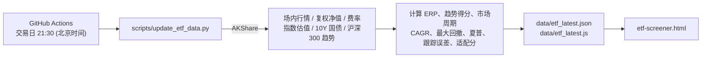

# life-tools

Small tools for daily life —— 生活工具箱 · LifeTools

一组**零构建、零依赖安装**的单文件 HTML 小工具合集，覆盖投资分析、宏观研究、量化筛选、学习复习与日常生活。每个工具都是一个独立的 `.html` 文件，双击即可在浏览器中打开使用，统一由 [index.html](index.html) 首页导航。

## ✨ 特性

- **单文件即工具**：HTML / CSS / JS 内联在同一文件中，无需 `npm install`、无需打包
- **开箱即用**：本地 `file://` 直接打开，或部署到 GitHub Pages 等任意静态托管
- **统一入口**：首页支持关键词搜索与分类筛选（投资 / 宏观 / 价值 / 量化 / 生活 等）
- **数据自动更新**：ETF 筛选器的行情数据由 GitHub Actions 在交易日自动抓取并提交

## 🧰 工具清单

### 投资 · 价值 · 量化

| 工具 | 文件 | 说明 |
| --- | --- | --- |
| 格雷厄姆廉价股计算器 | [graham-calculator.html](graham-calculator.html) | PE / PB / NCAV 多维度价值判断，EPS 均值计算，内在价值评级，含 AI 炒股提示词生成器 |
| DCF 现金流折现计算器 | [dcf-calculator.html](dcf-calculator.html) | DCF + PE + PB 三维估值，自由现金流预测、折现率调整、多情景模拟与敏感性分析 |
| 基金债券收益计算器 | [earnings-calculator.html](earnings-calculator.html) | 基金、债券的固定收益与预期收益计算 |
| 周期 ETF / 指数基金智能筛选器 | [etf-screener.html](etf-screener.html) | 股债性价比 ERP + 估值分位 + 均线动量三维周期诊断，六大类 ETF 多维筛选、同指数雷达 PK 与攻守仓位配比 |
| TAR 技术面分析手册 | [technical_analysis_guide_cn.html](technical_analysis_guide_cn.html) | K 线形态、量价关系、指标速查、市场情绪分析 |

### 宏观 · 认知

| 工具 | 文件 | 说明 |
| --- | --- | --- |
| 全球地缘战略地图 | [geopolitical-map.html](geopolitical-map.html) | GeoStrategy Atlas：地缘政治、宏观分析、国家间关系可视化（D3 + TopoJSON） |
| 认知成长核心书单与进阶追踪 | [reading_list_card.html](reading_list_card.html) | 经典著作结构化导读，涵盖认知跃迁、复杂系统与宏观决策，支持交互式阅读进度追踪 |

### 学习 · 生活

| 工具 | 文件 | 说明 |
| --- | --- | --- |
| 前端面试宝典 | [frontend-interview-guide.html](frontend-interview-guide.html) | 前端面试笔记复习，提供解题模式与答案对比 |
| iPhone 17 Pro Max 摄影与录像实战工坊 | [iphone17-pro-camera-master.html](iphone17-pro-camera-master.html) | 焦段透视、180° 快门、ProRAW 与 Apple Log 2 原理拆解，十大场景参数卡，构图与姿态引导 |
| 羽毛球费用 AA 计算器 | [badminton-cost-calculator.html](badminton-cost-calculator.html) | 多人场地 / 球费按人数与参与情况动态平摊 |
| 提肛运动计时器 | [anal-lifting-trainer.html](anal-lifting-trainer.html) | 训练倒计时与计数，可自定义组数、时长与强度 |

### 🚧 即将上线

- 仓位管理 · 凯利公式
- 股息再投资复利计算
- 宏观指标分析看板

## 🚀 快速开始

```bash
git clone https://github.com/longyi-xw/life-tools.git
cd life-tools
```

**方式一：直接打开**

双击 `index.html`，或任意工具的 `.html` 文件即可。

**方式二：本地静态服务（推荐，ETF 筛选器可通过 `fetch` 读取最新 JSON）**

```bash
# 任选其一
python -m http.server 8080
npx serve .
```

然后访问 <http://localhost:8080>。

> 部分页面会从公共 CDN 加载第三方库（ECharts、D3、TopoJSON、Font Awesome），离线环境下相关图表或图标可能无法显示。

## 📈 ETF 数据自动更新

[etf-screener.html](etf-screener.html) 的数据来源按优先级依次为：

1. `fetch ./data/etf_latest.json`（HTTP / HTTPS 访问时）
2. `<script src="./data/etf_latest.js">` 挂载的 `window.__ETF_LATEST_DATA__`（兼容 `file://` 直接打开）
3. 页面右上角手动导入 JSON / JS 文件
4. HTML 内置的兜底快照

### 数据流



- 工作流：[.github/workflows/update-etf.yml](.github/workflows/update-etf.yml)，周一至周五 UTC 13:30 定时执行，也支持在 Actions 页面手动触发（`workflow_dispatch`）
- 数据无变化（非交易日或接口均失败）时自动跳过提交
- 容错原则：任一接口失败、限流或超时都会保留上一版字段，仅更新成功获取的数据

### 本地手动更新

```bash
pip install akshare pandas

python scripts/update_etf_data.py                       # 联网全量更新
python scripts/update_etf_data.py --offline             # 不联网，仅按算法重算派生字段
python scripts/update_etf_data.py --sync-html-fallback  # 额外刷新 etf-screener.html 内置兜底快照
```

> [!IMPORTANT]
> 脚本中的 `MarketRegimeEngine` 与 `etf-screener.html` 中 `<script id="engine">` 的前端引擎逐行对齐，修改任何阈值或权重时请两边同步修改。

## 📁 目录结构

```text
life-tools/
├── index.html                        # 首页导航（搜索 + 分类筛选）
├── *.html                            # 各独立工具页面
├── data/
│   ├── etf_latest.json               # ETF 最新数据（HTTP 模式读取）
│   └── etf_latest.js                 # 同一份数据的 JS 包装（file:// 模式读取）
├── scripts/
│   └── update_etf_data.py            # ETF 数据采集与指标计算脚本
└── .github/workflows/
    └── update-etf.yml                # 交易日定时更新 ETF 数据
```

## ➕ 新增一个工具

1. 在根目录新建 `your-tool.html`，样式与脚本内联，尽量不引入构建依赖
2. 在 `<head>` 中补充 `<title>`、`description` 与内联 favicon，保持与现有页面一致
3. 在 [index.html](index.html) 的「已上线」区域添加一张 `tool-card`，填写 `href`、`data-name`（搜索关键词）与 `data-cat`（分类）
4. 在本 README 的工具清单中补充一行说明

提交信息约定：`[feat]` 新功能、`[fix]` 修复、`[chore]` 杂项 / 数据更新。

## ⚠️ 免责声明

本项目中的投资类工具（估值计算、ETF 筛选、技术分析等）仅用于学习与研究，所有数据与结论不构成任何投资建议。市场有风险，投资需谨慎。
